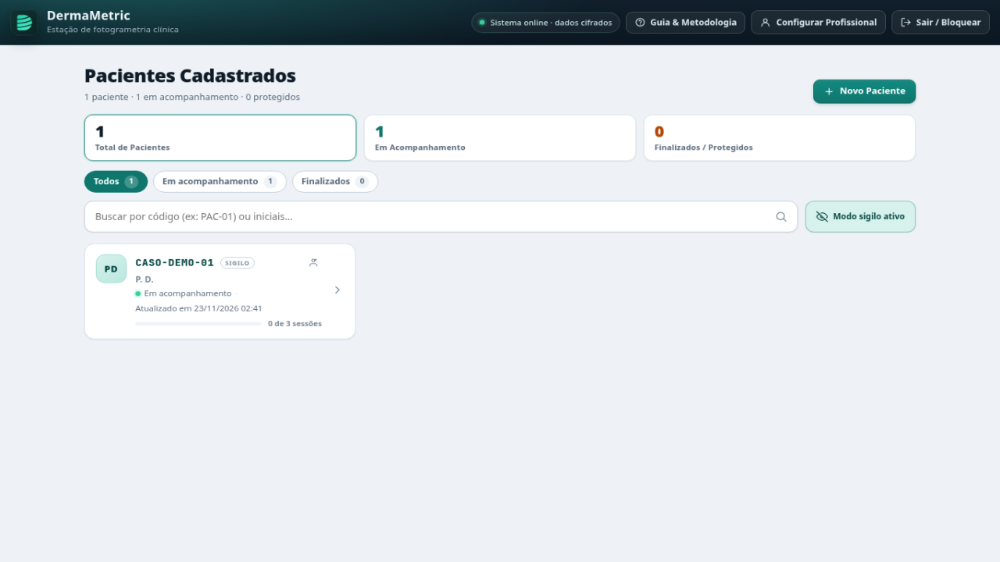
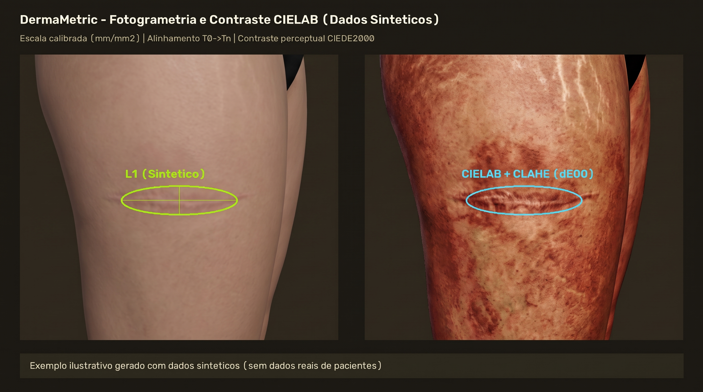
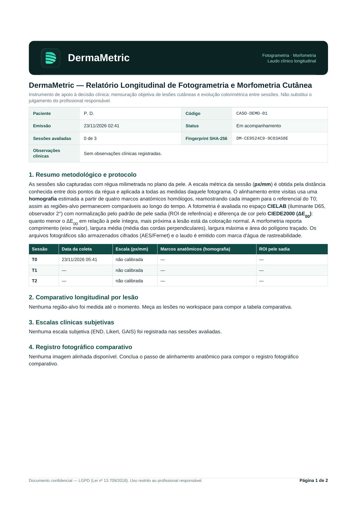
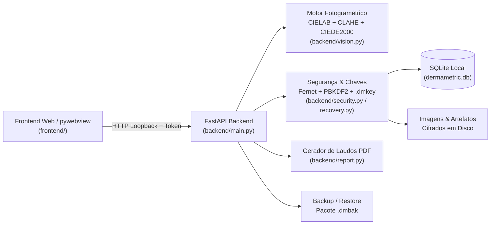

<div align="center">
  

  <h1>DermaMetric</h1>
  <p>
    <strong>Estação Clínica Local de Fotogrametria, Morfometria Cutânea e Laudos Longitudinais</strong>
  </p>

  <p>
    <a href="https://github.com/joaomaxdev/dermametric/releases/latest">
      
    </a>
    <a href="https://github.com/joaomaxdev/dermametric/actions/workflows/build-windows.yml">
      
    </a>
    
    
  </p>

  <p>
    <a href="#instalação-rápida-windows">Instalação Windows</a> •
    <a href="#instalação-rápida-linux">Instalação Linux</a> •
    <a href="#recursos-clínicos">Recursos Clínicos</a> •
    <a href="#guia-rápido-da-clínica">Guia da Clínica</a> •
    <a href="#arquitetura-e-engenharia">Arquitetura &amp; Engenharia</a> •
    <a href="#segurança-e-privacidade-boas-práticas-lgpd">Segurança &amp; LGPD</a> •
    <a href="#apoie-o-projeto">Apoie o Projeto</a>
  </p>
</div>


---

## Visão Geral

O **DermaMetric** é uma estação clínica **100% local (*offline-first*)** de fotogrametria e morfometria para acompanhamento objetivo e longitudinal de lesões, estrias e regiões cutâneas — aplicável a qualquer paciente, área anatômica ou protocolo dermatológico e estético.

Projetado para consultórios, clínicas e pesquisadores, o sistema combina **precisão metrológica** (calibração por régua milimetrada, alinhamento geométrico automático e análise colorimétrica clínica) com **privacidade total**: nenhum prontuário, foto ou dado do paciente é enviado para a nuvem.

Funciona como **aplicativo desktop nativo de duplo clique** no Windows e no Linux (`AppImage` ou instalador automático), sem necessidade de internet, assinaturas ou servidores externos.

> **Aviso Clínico e Regulatório:** O DermaMetric é uma **ferramenta de apoio ao registro, à documentação e à medição fotogramétrica/colorimétrica** conduzida por profissional habilitado. Ele **não substitui avaliação clínica ou médica presencial**, não emite diagnóstico médico autônomo e não deve ser utilizado de forma isolada para decisões terapêuticas.

## Demonstração Visual (Dados Sintéticos)

- **Estação Clínica e Prontuários** *(interface local sem dependência de nuvem)*:

  

- **Fotogrametria e Contraste CIELAB** *(visualização ilustrativa gerada com dados sintéticos)*:

  

- **Laudo Clínico em PDF** *(relatório estruturado para impressão ou arquivo)*:

  

---

## Recursos Clínicos

- **Acompanhamento Longitudinal (`T0`, `T2`, `T3`, `T4`…):** protocolo organizado por consultas seriadas, com par fotográfico por sessão:
  - **Foto com régua milimetrada:** calibra automaticamente a escala real em milímetros;
  - **Foto limpa (sem régua):** utilizada para alinhamento, análise de cor e medição de até **4 regiões-alvo (`L1` a `L4`)** com descrição clínica editável.
- **Alinhamento Automático entre Consultas:** sobreposição espacial das fotos de retorno (`Tn`) em relação à consulta inicial (`T0`) por meio de **4 pontos anatômicos de referência**, compensando distância, rotação e inclinação da câmera.
- **Padronização de Iluminação:** normalização fotométrica automática com base na pele saudável adjacente, reduzindo variações de luz entre sessões.
- **Medições Objetivas Sub-milimétricas:**
  - **Área (`mm²`)** e **Comprimento (`mm`)** da região demarcada;
  - **Largura média e largura máxima (`mm`)** ao longo do eixo da lesão;
  - **Contraste perceptual (`ΔE00`):** diferença colorimétrica clínica (CIEDE2000) entre a lesão e a pele saudável ao redor.
- **Escalas Clínicas e Avaliação Cega:** registro integrado de **Dor (END `0–10`)**, **Satisfação (`1–5`)**, **GAIS (`−1` a `+3`)** e modo de comparação lado a lado sem identificação das datas para avaliação imparcial.
- **Laudo Clínico em PDF:** emissão imediata de relatório profissional pronto para imprimir ou anexar ao prontuário, contendo mapas anatômicos, recortes comparativos e tabela evolutiva.
- **Área de Trabalho Otimizada:** visualização ampla com lupa de precisão `4×`, atalhos de zoom e modo foco no canvas.

---

## Guia Rápido da Clínica

### Instalação Rápida (Windows)

1. Acesse a aba **Releases** do repositório e baixe o instalador **`DermaMetric-Setup.exe`**.
2. Dê duplo clique e siga o assistente. **Não exige senha de administrador** nem instalação de programas adicionais.
3. O instalador cria atalhos na **Área de Trabalho** e no **Menu Iniciar**.

### Instalação Rápida (Linux)

Escolha a forma mais prática para o seu computador (**não exige `sudo`**):

- **Instalador automático:** baixe `packaging/install-linux.sh` e execute no terminal (`bash install-linux.sh` para instalar com atalhos no Menu e Área de Trabalho, ou `bash install-linux.sh --uninstall` para remover preservando `data/`).
- **AppImage portátil:** baixe **`DermaMetric-x86_64.AppImage`** na seção de **Releases**, habilite a execução como programa (`chmod +x DermaMetric-x86_64.AppImage` ou via propriedades do arquivo) e abra com duplo clique.

Todos os dados permanecem salvos apenas no computador da clínica:

- **Windows:** `%LOCALAPPDATA%\DermaMetric\data`
- **Linux:** `~/.local/share/dermametric/data`

### Primeiro Acesso e Chave de Recuperação (`.dmkey`)

Ao abrir o programa pela primeira vez, crie a **senha mestra** da estação clínica e:

1. Baixe o **arquivo-chave `.dmkey`** exibido na tela.
2. Guarde-o em local seguro (pendrive exclusivo ou cofre de senhas), **fora** do computador da clínica.
3. Anote e proteja sua senha mestra.

> **Atenção:** Sem a senha mestra **e** o arquivo `.dmkey`, os prontuários cifrados não podem ser recuperados em caso de troca de máquina ou formatação.

### Backup e Encaminhamento de Casos (`.dmbak`)

- **Backup completo da clínica:** acesse o **Perfil** no topo da tela → **Backup e Restauração (`.dmbak`)** → digite a senha mestra → **Exportar Backup Completo (`.dmbak`)**.
- **Exportar um caso individual:** dentro do prontuário do paciente, clique em **Exportar `.dmbak`** para gerar um arquivo cifrado isolado (ex.: `PAC-AB12CD.dmbak`), ideal para encaminhamento entre profissionais.
- **Restauração segura:** selecione o arquivo `.dmbak`, clique em **Inspecionar arquivo** para conferir data e quantidade de pacientes e escolha entre **Mesclar** (mantém os registros atuais) ou **Substituir dados clínicos**. Antes de gravar, o sistema salva automaticamente uma cópia de segurança preventiva.

### Recuperação de Acesso

Se a senha mestra for esquecida ou o sistema for instalado em um novo computador:

1. Na tela de bloqueio, clique em **Recuperar acesso com arquivo-chave (`.dmkey`)**.
2. Selecione o `.dmkey` salvo anteriormente (ou informe o código de emergência).
3. Defina uma nova senha mestra e salve o **novo `.dmkey`**.

---

## Arquitetura e Engenharia

### Stack Principal

- **Backend & API:** Python, **FastAPI** e **Uvicorn**, com persistência local em **SQLite** (`backend/database.py`, `backend/main.py`, `backend/models.py`).
- **Visão Computacional & Metrologia:** **OpenCV** (`opencv-python-headless`), **NumPy** e **SciPy** para calibração por régua milimetrada, alinhamento geométrico, normalização em espaço **CIELAB**, realce **CLAHE**, morfometria em `mm`/`mm²` e contraste perceptual **CIEDE2000** (`ΔE00`) em `backend/vision.py`.
- **Laudos & Janela Desktop:** **ReportLab** para geração de PDFs (`backend/report.py`) e **pywebview** (`desktop_launcher.py`) com integração nativa em desktop e fallback automático de navegador.
- **Testes Automatizados:** **pytest** cobrindo pipeline de visão, marca d'água, backup/restauração `.dmbak`, modais frontend e janela desktop (`tests/`).

### Fluxo de Dados e Execução



### Criptografia e Derivação de Chaves

- **Cifragem em repouso:** textos sensíveis e arquivos binários utilizam `Fernet` (`AES-128-CBC` com `HMAC-SHA256`, chave de 256 bits) via `backend/security.py`.
- **Envelope da chave de dados (`DEK`) e recuperação (`.dmkey`):** a `DEK` efetiva pode ser embrulhada a partir da senha mestra ou de uma chave de recuperação `.dmkey` usando **PBKDF2-HMAC-SHA256** com salt aleatório de 16 bytes e **200.000 iterações** (`backend/recovery.py`). A senha de acesso/PIN da aplicação também é verificada com `PBKDF2-HMAC-SHA256` (`backend/auth.py`).
- **Pacotes de backup (`.dmbak`):** o arquivo interno contém manifesto com `SHA-256` de cada item e é cifrado com material derivado via **PBKDF2-SHA256** (200.000 iterações + salt aleatório de 16 bytes) para `Fernet` e `HMAC-SHA256` (`backend/backup.py`).

### Testes e Pipeline de Empacotamento / CI/CD

- **Execução local dos testes:**
  ```bash
  .venv/bin/pytest -q
  ```
- **Empacotamento e instaladores:**
  - **Linux:** `packaging/build-linux.sh` gera o bundle/AppImage (`DermaMetric-x86_64.AppImage` e `.tar.gz`), enquanto `packaging/install-linux.sh` instala em ambiente isolado no usuário sem `sudo`, cria atalhos `.desktop` (`packaging/dermametric.desktop`) e oferece `--smoke-test` e `--uninstall` preservando `data/`.
  - **Windows:** `packaging/dermametric.spec` (PyInstaller) e `packaging/installer.iss` (Inno Setup) geram o instalador de usuário `DermaMetric-Setup.exe`.
- **GitHub Actions (`.github/workflows/build-linux.yml` e `build-windows.yml`):** workflows automatizados que compilam os binários/instaladores, executam verificação de sanidade e publicam os artefatos nas releases disparadas por tags `v*` (ou via `workflow_dispatch`).

---

## Segurança e Privacidade (Boas Práticas LGPD)

O DermaMetric adota **boas práticas** técnicas de minimização e proteção de dados sensíveis em alinhamento com os princípios da **LGPD** (a conformidade organizacional completa da clínica também depende de processos internos, consentimento e governança do controlador):

- **Dados 100% locais e cifrados:** nenhum prontuário, medição ou fotografia é enviado a servidores externos por padrão.
- **Criptografia em repouso:** campos sensíveis e arquivos de imagem são cifrados em disco com `Fernet` (`AES-128-CBC` + `HMAC-SHA256`), com chave de dados (`DEK`) protegida por envelope via `PBKDF2-SHA256` (200.000 iterações) e arquivo-chave de recuperação `.dmkey`.
- **Backups protegidos e íntegros:** arquivos `.dmbak` empacotam registros e blobs com `SHA-256` e são cifrados com chave derivada por `PBKDF2-SHA256` + autenticação `HMAC-SHA256`.

---

## Apoie o Projeto

O **DermaMetric** é um software **open-source** gratuito, desenvolvido de forma independente para oferecer fotogrametria clínica de precisão sem mensalidades.

Se o projeto agrega valor à sua clínica, pesquisa ou prática profissional, você pode apoiar o desenvolvimento contínuo via **Pix**

- **Chave Pix:** `ab5283df-d213-4266-8a02-380b52cf279f`

Você também pode apoiar gratuitamente:
- Deixando uma **Star ⭐** neste repositório;
- Compartilhando o DermaMetric com colegas da área clínica e acadêmica;
- Abrindo **Issues** com sugestões ou contribuindo via **Pull Requests**.

---

## Executar a Partir do Código-Fonte (Desenvolvedores)

Para rodar o ambiente de desenvolvimento ou contribuir com o código:

```bash
python3 -m venv .venv
.venv/bin/pip install -r requirements.txt

# Iniciar servidor backend local
.venv/bin/uvicorn backend.main:app --reload --port 8000

# Ou iniciar a janela desktop nativa
.venv/bin/python desktop_launcher.py

# Executar suíte de testes
.venv/bin/pytest -q
```

---

<div align="center">
  <p>Desenvolvido por <strong>joaomaxdev</strong></p>
</div>
